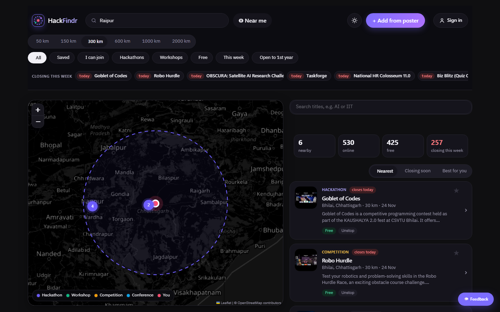

# HackFindr: built with Gemma 4

**Built at Hackasol 5.0 · Track 1: Open Innovation (OI-01), "Build for Real-World Impact".**

College students, especially outside the big metros, miss hackathons, workshops and competitions they could
join, because the information is spread across many websites, WhatsApp groups and notice boards, eligibility
rules are buried in long pages, and deadlines pass unnoticed.

HackFindr puts upcoming student events from **Unstop, Devpost, Devfolio, KnowAFest, Hack2skill, HackerEarth,
Codeforces and MLH** on one map, tells each student **which events they can actually join**, ranks them by
**how well they fit**, and **emails a reminder** before registration closes.

It is built with **Gemma 4 (`gemma-4-26b-a4b-it`) through the Gemini API** (`google-genai`).



Presentation: [docs/HackFindr_presentation.pptx](docs/HackFindr_presentation.pptx)

## Features

**Find events**
- **Map and list side by side.** The map stays in view while the list scrolls. Pins are coloured by type and
  numbered when several events share a place.
- **Your city or Near me**, with a radius from 50 to 2000 km. Online events are listed too.
- **One-tap filters:** Saved, **I can join**, Hackathons, Workshops, Free, This week, Open to 1st year.
- **Search by title** and sort by **Nearest**, **Closing soon** or **Best for you**.
- Counts of nearby, online, free and closing-this-week events, a *Closing this week* strip, red badges when
  registration closes soon. Events that have ended are hidden.

**Personal: sign in with Google**
- **Profile:** college, city, year, branch, skills, interests, usual team size. All optional.
- **Eligibility on every card:** ✅ Eligible, ❌ Not eligible *with the reason* ("Open to 2nd years and 3rd years"),
  or ❓ Check details ("Teams of 1–2; yours is 3", "Only for students from Odisha").
  Gemma reads each event's rules **once** (years, branches, team size, women-only, state-only, fee); plain code
  then compares them with the profile.
- **⭐ Best fit:** Gemma scores up to 25 eligible events from 0 to 100 against your skills, interests, year and
  distance, with a one-line reason ("Matches your Python + ML skills; online, so no travel"). A **Top 5 for you
  this week** row sits above the list. It learns from your "Is this for me?" checks. If Gemma is busy it falls
  back to a keyword match.
- **Saved events** sync between your devices.

**Reminders**
- Opt-in emails **3 days and 1 day before** a saved event's registration closes.
- An optional **Monday digest** with your top 5 best-fit events.
- Every email has a signed one-click **unsubscribe** link. A **Send me a test email** button is in the profile.

**Event details**
- Opens straight away with dates, place, team size and a **Register** button; the AI summary loads a moment later.
- **Add to calendar** (.ics) and **copy a link** to one event.
- **Gemma helpers:** a chat that answers only from this event's details, **"Is this for me?"**, a
  **team-invite message** for WhatsApp, and a side-by-side **compare** with another event.

**Add events**
- **Add from poster:** upload a photo of a notice-board poster; Gemma fills in the details, you check them and add
  the event to the map.

**At the event**
- **💬 Feedback** button: anonymous star rating, favourite feature and a comment.
- **`/share`**: a printable page with a big QR code to the app. **`/stats?key=…`**: usage and feedback numbers
  (the key is printed when the app starts).

Works on laptops and phones, in day and night mode.

## Problem validation

*To fill in from the survey: see [docs/survey.md](docs/survey.md). Only real numbers.*

- **N** students from **K** colleges answered.
- **X%** check 4 or more places to find events.
- **Y%** missed an event because they found out too late.
- **Z%** started registering for an event they weren't eligible for.

## Measured impact

*To fill in from the timed test: see [docs/impact-test.md](docs/impact-test.md).*

| Finding 3 events you can join | Before | With HackFindr |
|---|---|---|
| Median time | ? min | ? min |
| Websites opened | ? | 1 |
| Wrong picks (ineligible or closed) | ? | ? |

Usage at Hackasol 5.0 (from `/stats`): **?** visitors, **?** accounts, average rating **?/5**.

## How to run

```
python -m venv .venv
.venv\Scripts\activate            # Mac/Linux: source .venv/bin/activate
pip install -r requirements.txt
copy .env.example .env            # then put your GEMINI_API_KEY in .env
python events.py                  # optional: fetch fresh events into events.json
python app.py                     # open http://127.0.0.1:7860
```

Optional settings in `.env` (all explained in `.env.example`):
- **Google sign-in:** `GOOGLE_CLIENT_ID` and `GOOGLE_CLIENT_SECRET`, with `http://localhost:7860/auth` as a
  redirect URI. Without them, a local *Sign in (demo)* button is shown instead.
- **Reminder emails:** `SMTP_USER` and `SMTP_PASSWORD` (a Gmail App password). Without them, emails are saved to
  `data/outbox/` instead of being sent.

To open it from a phone on the same Wi-Fi, start it with `python app.py --lan` and open the second address it
prints. Google sign-in only works on `localhost` or an HTTPS address, so for sign-in on other devices use an HTTPS
tunnel and set `HACKFINDR_PUBLIC_URL` (see [docs/deployment.md](docs/deployment.md)).

If the internet or an API is down, the app uses the saved `events.json` (offline demo mode).
To read every event's eligibility rules at once instead of in the background: `python eligibility.py`.

## Website mode
Set `HACKFINDR_PUBLIC=1` (and `GEMINI_API_KEY` as a secret) on the host. This hides manual fetching, refreshes
events in the background every 6 hours, and limits Gemma use per visitor and per day. Set `HACKFINDR_DATA_DIR` to
a persistent folder if the host has one. Hosting options and the Gemma cost per 1,000 students are in
[docs/deployment.md](docs/deployment.md).

## Privacy
- Google sign-in only; HackFindr never sees a password. Profile fields are optional and used only for matching.
- **Delete my account** removes the profile, saved events, fit checks and email history at once.
- Emails are opt-in with a one-click unsubscribe. Usage stats store no names, emails or IP addresses.
- Personal data lives in `data/`, which is git-ignored.

## How it works
| File | What it does |
|---|---|
| `events.py` | fetch every source in `SOURCES`, normalize to one schema, geocode cities (`geocache.json`), Gemma summaries (`summary_cache.json`), save `events.json` |
| `eligibility.py` | Gemma reads each event's rules once (`eligibility_cache.json`); plain-code match with the profile; Best fit ranking with Gemma, cached per student per day |
| `accounts.py` | SQLite database in `data/`: users, saved events, fit checks, email history |
| `auth.py` | the FastAPI app around Gradio: Google sign-in, `/unsubscribe`, `/share`, `/qr.png`, `/stats` |
| `reminders.py`, `mailer.py` | reminder and digest emails, checked every hour; Gmail SMTP or the `data/outbox/` folder |
| `usage.py` | anonymous usage counts and feedback |
| `harness/tools.py` | event search and distance filter used by the map |
| `app.py` | starts `app_template/app.py` (hosting services such as Hugging Face Spaces run this file) |
| `app_template/app.py` | Gradio UI: map, list, filters, details panel with Gemma helpers, poster upload, profile, feedback |
| `gemma_client.py` | the starter's Gemma 4 helper (spacing, retries, cache) |
| `skills/hackfindr/SKILL.md` | agent skill describing how to use the tools |

**Stack:** Python, Gradio 6 inside FastAPI (uvicorn), Folium/Leaflet with OpenStreetMap, SQLite, Authlib (Google
OAuth), Gemma 4 via `google-genai`, BeautifulSoup and requests for fetching, geopy (Nominatim) for geocoding.

Distance is the straight-line (haversine) distance from the city you type.
Geocoding uses OpenStreetMap Nominatim at most once per second.

Built on the Gemma 4 hackathon starter.

## License
MIT, see `LICENSE`.
